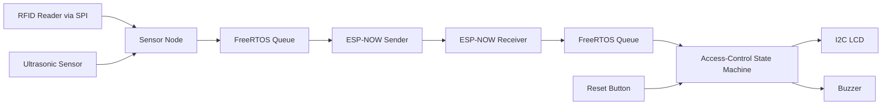

# ESP32 Embedded Systems Projects

Embedded systems projects built with **ESP32-S3**, **C/C++**, the **Arduino framework**, and **FreeRTOS**. The repository includes a two-node wireless access-control prototype and four progressively more advanced labs covering GPIO, low-level peripherals, communication, scheduling, and multicore synchronization.

## Project — Distributed Access Control and Intrusion Detection

**Code:** [Edge sensor node](https://github.com/ChangSungPo/ESP32/tree/master/FinalProject/FinalProject_edge_sensor) · [Controller node](https://github.com/ChangSungPo/ESP32/tree/master/FinalProject/FinalProject_controller)

A distributed security-system prototype that uses two ESP32-S3 boards. The sensor node detects RFID cards and nearby objects, then sends events wirelessly to a controller that manages system state, an LCD, and an alarm buzzer.



### Sensor Node (Node 1)

- **RFID authentication input:** Reads MFRC522 cards over **SPI** and serializes UID readings into event messages.
- **Ultrasonic proximity sensing:** Uses trigger/echo pulse timing to estimate distance, with consecutive-sample thresholds to suppress transient alarms.
- **FreeRTOS concurrency:** Runs ultrasonic sensing and RFID polling on Core 0, and ESP-NOW network transmission on Core 1.
- **Producer–consumer design:** Sensor tasks send structured events into a FreeRTOS queue; a network task receives and forwards them.
- **Low-level timing:** Configures and reads a hardware timer through timer-group registers.

### Controller Node (Node 2)

- Receives events over **ESP-NOW** and passes them to a **FreeRTOS queue** for application-level processing.
- Implements an access-control **finite-state machine** with `SYSTEM_ARMED`, `ACCESS_GRANTED`, and `BREACH_ALARM` states.
- Checks incoming RFID UIDs against a local authorization list; processes ultrasonic intrusion events.
- Displays system messages on an **I2C LCD**, drives a buzzer through PWM tone output, and accepts a physical reset button.
- Includes a disabled-by-default offline simulation task to test the event-processing flow.

**Technologies:** ESP32-S3 · FreeRTOS · Dual-core task affinity · ESP-NOW · SPI · RFID (MFRC522) · Ultrasonic sensing · Hardware timer registers · FreeRTOS queues · Finite-state machine · I2C · PWM · Event-driven processing.

> **Prototype limitations:** RFID UIDs are matched against hard-coded values and ESP-NOW encryption is disabled in the current code. This is an educational prototype rather than a production-secure access-control system. The two node source files contain their respective author credits. Validate callback context, queue initialization order, and packet-length checks before deployment.

---

## Lab 1 — GPIO and Digital I/O

**[Browse Lab 1](https://github.com/ChangSungPo/ESP32/tree/master/Lab1)**

| Part | Implementation | Key techniques |
| --- | --- | --- |
| [Part 1](https://github.com/ChangSungPo/ESP32/tree/master/Lab1/Lab1Part1) | Blink two LEDs at different intervals using a reusable `blinkLED()` function. | GPIO output, `pinMode()`, `digitalWrite()`, blocking `delay()` |
| [Part 2](https://github.com/ChangSungPo/ESP32/tree/master/Lab1/Lab1Part2) | Control an LED using a push button. | GPIO input, `digitalRead()`, `INPUT_PULLUP`, active-low logic |
| [Part 3](https://github.com/ChangSungPo/ESP32/tree/master/Lab1/Lab1Part3) | Toggle independent flashing states with two buttons. | Boolean state management, C++ reference parameters, basic button debouncing |

**Skills:** Embedded C++ · GPIO · Digital I/O · Pull-up inputs · State management.

## Lab 2 — Registers, Timers, ADC and PWM

**[Browse Lab 2](https://github.com/ChangSungPo/ESP32/tree/master/Lab2)**

| Part | Implementation | Key techniques |
| --- | --- | --- |
| [Part 1](https://github.com/ChangSungPo/ESP32/tree/master/Lab2/Lab2Part1) | Control a GPIO pin through memory-mapped registers and benchmark 1,000 toggles against `digitalWrite()`. | MMIO, volatile pointers, GPIO registers, bit masks, `micros()` |
| [Part 2](https://github.com/ChangSungPo/ESP32/tree/master/Lab2/Lab2Part2) | Configure the hardware timer and periodically toggle an LED without using a blocking interval delay. | Timer-group registers, prescaler, auto-reload configuration, elapsed-time checks |
| [Part 3](https://github.com/ChangSungPo/ESP32/tree/master/Lab2/Lab2Part3) | Read a photoresistor and use inverse brightness mapping to drive an LED. | ADC, 12-bit sensor readings, LEDC PWM, sensor feedback |

**Skills:** Register-level programming · Bitwise operations · Hardware timers · ADC · PWM · Performance measurement.

## Lab 3 — Communication, Scheduling and Interrupts

**[Browse Lab 3](https://github.com/ChangSungPo/ESP32/tree/master/Lab3)**

| Part | Implementation | Key techniques |
| --- | --- | --- |
| [Part 1](https://github.com/ChangSungPo/ESP32/tree/master/Lab3/Lab3part1) | Receive text over Serial and send commands/data to a 16×2 LCD using manual I2C transfers. | I2C (`Wire`), UART/Serial, command bytes, bit masks, high/low nibbles, input buffering |
| [Part 2](https://github.com/ChangSungPo/ESP32/tree/master/Lab3/Lab3part2) | Dispatch four functions by priority: LED blinker, LCD counter, buzzer music output, and alphabet printer. | Custom TCB, function pointers, priority rotation, cooperative function dispatch, PWM |
| [Part 3](https://github.com/ChangSungPo/ESP32/tree/master/Lab3/Lab3part3) | Display timer, button, and BLE write events on an LCD. | BLE GATT server, callbacks, timer ISR, GPIO interrupt, `volatile` flags, event handling |

**Skills:** I2C · UART · BLE · Custom scheduling · TCBs · Function pointers · Interrupts · Event-driven programming.

> Part 2 is a priority-based **non-preemptive** function dispatcher, not a complete preemptive operating-system scheduler.

## Lab 4 — FreeRTOS Scheduling and Multicore Synchronization

**[Browse Lab 4](https://github.com/ChangSungPo/ESP32/tree/master/Lab4)**

### Part 1 — SRTF-Style Task Scheduler

**[Source](https://github.com/ChangSungPo/ESP32/tree/master/Lab4/Lab4part1)**

- Creates three FreeRTOS worker tasks for LED blinking, LCD counting, and Serial alphabet output, plus a coordinating scheduler task.
- Selects a worker based on **Shortest Remaining Time First (SRTF)** using configured remaining-time budgets.
- Uses a **100 ms scheduling quantum** with `vTaskResume()`, `vTaskSuspend()`, `vTaskDelay()`, and `xTaskGetTickCount()`.
- Models periodic re-arrival/cooldown for tasks; includes Doxygen-style documentation.

**Skills:** FreeRTOS · Scheduling algorithms · Task control · Core pinning · Time slicing · Doxygen.

> The remaining-time budgets are simulated rather than derived from actual measured CPU execution time; this is an instructional SRTF-style scheduler layered on FreeRTOS.

### Part 2 — Dual-Core Processing and Shared-State Synchronization

**[Source](https://github.com/ChangSungPo/ESP32/tree/master/Lab4/Lab4part2)**

- **Core 0:** Samples a photoresistor, computes a **five-sample simple moving average (SMA)** using a circular buffer, and updates an I2C LCD.
- **Core 1:** Monitors light-level thresholds to trigger an LED alarm and independently computes prime numbers.
- Coordinates access to shared sensor readings, SMA values, and update flags using a **FreeRTOS binary semaphore**.
- Uses `xTaskCreatePinnedToCore()` to place tasks on specific ESP32 cores.

**Skills:** Dual-core FreeRTOS · Multitasking · Semaphores · Synchronization · Circular buffers · Sliding-window processing · Anomaly detection.

---

## Supplementary Scheduler Exercises

| Exercise | Topics |
| --- | --- |
| [ICTE 4](https://github.com/ChangSungPo/ESP32/tree/master/ICTE4) | Round-robin-style polling, TCB, function pointers, hardware timer registers, direct GPIO manipulation, potentiometer readings |
| [ICTE 5 — Part 1](https://github.com/ChangSungPo/ESP32/tree/master/ICTE5/ICTE5_part1) | Non-preemptive round-robin execution with a function-pointer array |
| [ICTE 5 — Part 2](https://github.com/ChangSungPo/ESP32/tree/master/ICTE5/ICTE5_part2) | TCB-based task states, run intervals, timestamps, and function pointers |

## Technology Stack

| Category | Technologies |
| --- | --- |
| **Platform & language** | ESP32-S3, C/C++, Arduino |
| **Low-level embedded** | GPIO, MMIO, bitwise operations, hardware timers, interrupts/ISRs, ADC, PWM |
| **Operating systems** | FreeRTOS, task priorities, task control, core affinity, SRTF-style scheduling |
| **Concurrency** | Dual-core task execution, binary semaphores, producer–consumer queues |
| **Communication** | I2C, SPI, UART/Serial, BLE GATT, ESP-NOW |
| **Data and application logic** | Circular buffers, moving averages, threshold-based anomaly detection, finite-state machines |
| **Developer tools** | Arduino IDE, Serial Monitor, Doxygen-style comments |

## Repository Structure

```text
ESP32/
├── FinalProject/
│   ├── FinalProject_edge_sensor/    # RFID + ultrasonic + ESP-NOW sender
│   └── FinalProject_controller/     # ESP-NOW receiver + FSM + LCD + buzzer
├── Lab1/                             # GPIO and button control
├── Lab2/                             # Registers, timers, ADC, PWM
├── Lab3/                             # I2C, scheduling, BLE, interrupts
├── Lab4/                             # FreeRTOS scheduling and synchronization
├── ICTE4/                            # Hardware-timed task scheduler
└── ICTE5/                            # Function-pointer and TCB exercises
```
